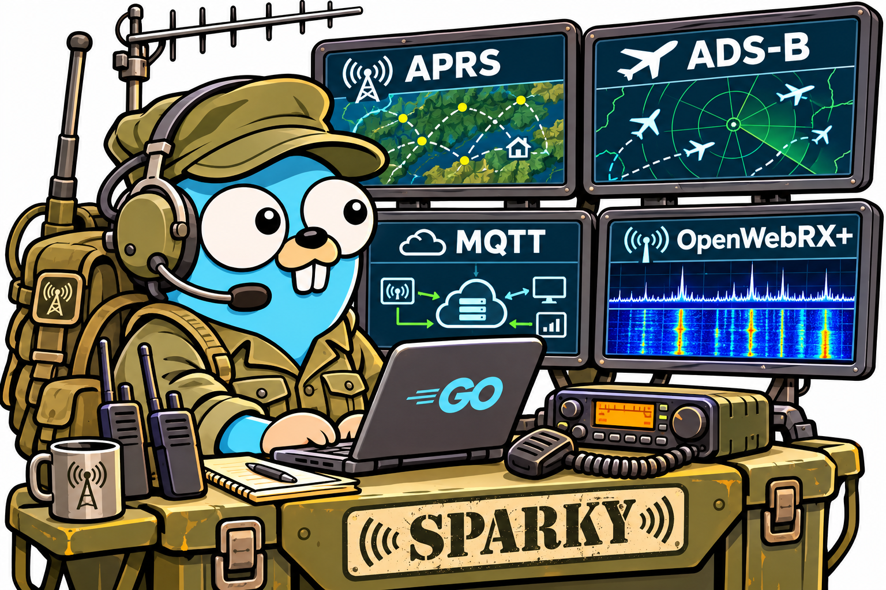

<p align="center">
  
</p>

# Sparky

<p align="center">Radio data, connected.</p>

<p align="center">
  
</p>

Sparky is an open-source radio data gateway written in Go. It receives, processes, and routes radio data between receivers, transmitters, and network services. Today it focuses on **APRS** and **ADS-B**, with room for additional protocols and hardware backends as the project evolves.

Sparky began as an RTL-SDR APRS iGate, inspired by [Ionosphere](https://github.com/cceremuga/ionosphere). Its current capabilities extend beyond an iGate.

## Why Sparky?

The name is a nod to **Sparky**, the radio operator Radar frequently talks to in *M\*A\*S\*H*. He's the voice at the other end of the radio, helping messages get where they need to go. That's a fitting namesake for software that listens to radio traffic and routes it between the airwaves and connected services.

## Current capabilities

### APRS
- Receive APRS through an RTL-SDR with `rtl_fm` and `multimon-ng`, or from a sound-card audio input.
- Receive decoded APRS reports from OpenWebRX+ over MQTT (instead of the local receive decoder).
- Parse and deduplicate APRS packets, gate RF traffic to APRS-IS, and optionally gate eligible APRS-IS messages back to RF.
- Digipeat using configurable path and alias rules; transmit AFSK1200 through sound-card audio.
- Schedule RF and APRS-IS beacons, with optional aprs.fi verification and watchdog checks.

### ADS-B and MQTT
- Accept OpenWebRX+ MQTT reports using an external broker or an optional loopback-only embedded broker.
- Forward OpenWebRX+ ADS-B reports to map.flights over MQTT, with forwarding diagnostics.

**Scope:** ADS-B forwarding relies on OpenWebRX+ to decode aircraft reports; Sparky does not currently decode raw ADS-B samples itself. The embedded MQTT broker is provided for the local OpenWebRX+ integration, not as a general-purpose public broker. RF transmission currently uses a sound-card audio output and an external radio; native RF transmitter-module control is not yet implemented.

## Getting Started
First you need to install the dependencies. Make sure you are running the latest version of Go or at least the version specified in the go.mod file.

### Dependencies
**Build dependencies (all configurations):** `pkg-config` and the PortAudio development headers are required because the capture package currently imports PortAudio unconditionally, including for MQTT-only use. On Debian/Ubuntu, install `pkg-config` and `portaudio19-dev` before building.

**Runtime dependencies (depending on backend):**

* An RTL-SDR compatible device (for SDR reception).
* [rtl_fm](http://osmocom.org/projects/sdr/wiki/rtl-sdr) (for SDR reception)
* [multimon-ng](https://github.com/EliasOenal/multimon-ng) (for local audio decoding)
* [alsa-utils](https://alsa-project.org/wiki/Main_Page) (`aplay`) when using the soundcard transmitter
 
- Go 1.22.4 or later (see `go.mod`)

## Usage

### Receiving APRS from OpenWebRX+

OpenWebRX+ can publish decoded APRS reports to MQTT. By default, Sparky subscribes to an existing broker:

```yaml
openwebrx-mqtt:
  enabled: true
  broker: tcp://127.0.0.1:1883
  topic: openwebrx/APRS
  username: ""
  password: ""
```

With this enabled, MQTT replaces Sparky's RTL-SDR/sound-card receive decoder. Frames that contain a complete TNC2 packet are passed through the normal iGate and digipeater processing. The configured sound-card transmitter can still be used for RF transmission. Configure the broker and topic to match OpenWebRX+; its APRS report topic is usually `openwebrx/APRS`.

To remove Mosquitto from the APRS receive path, enable Sparky's embedded broker and point OpenWebRX+ at `127.0.0.1:1884` (SSL off; it is a same-machine connection):

```yaml
openwebrx-mqtt:
  enabled: true
  topic: openwebrx/APRS
  embedded-broker:
    enabled: true
    listen-address: 127.0.0.1:1884
map-flights:
  enabled: true
  broker: ssl://mqtt.map.flights:8883
  station: N7RIX
  key: "YOUR_MAP_FLIGHTS_STATION_KEY"
  topic: openwebrx/ADSB
```

The embedded broker binds only to loopback and allows anonymous connections, so OpenWebRX+ must run on the same machine. The map.flights station name is sent as the MQTT username and the station key as its password over TLS. Sparky forwards only reports whose topic matches `map-flights.topic` and whose JSON mode is `ADSB`; APRS and other OpenWebRX+ reports stay on the local path. Use a distinct map.flights key for this Sparky connection and disable the old Mosquitto bridge using that key, since map.flights allows one active connection per station key.

The feed sends aircraft reports as OpenWebRX+ produces them. The receiver must keep OpenWebRX+'s 1090 MHz ADS-B background decoder running continuously for a continuous feed. This removes the local Mosquitto hop from APRS processing and lets Sparky publish ADS-B directly; it does not change the time OpenWebRX+ takes to decode reports.

When map.flights forwarding is enabled, Sparky logs a once-per-minute ADS-B forwarding summary with incoming reports, completed QoS 0 MQTT publishes, failures, rejected reports, queue drops, queue depth, connection state, and age of the last received report. A completed QoS 0 publish only means Sparky's MQTT client completed the send; MQTT does not confirm that map.flights displayed the aircraft. Check the station page separately for ingestion and display.

### Installing with make

#### Build the application
`make build`

#### Run the application
`make run`

### Installing the service with make
`make install-service`

### Running the application for testing

```bash
go run .
```

### Log rotation

Systemd writes APRS logs to `/var/log/aprs.log` by default. Install the logrotate policy to keep the file from growing unbounded:

1. Copy `scripts/aprs.logrotate` to `/etc/logrotate.d/aprs` (requires sudo).
2. Adjust thresholds (e.g. `size`, `rotate`) if your environment needs different retention.
3. Run `sudo logrotate -f /etc/logrotate.d/aprs` once to verify the policy.

The provided config rotates whenever the log hits 50 MB, keeps 10 compressed archives, skips missing/empty logs, and uses `copytruncate` so the running service keeps logging.

### APRS-IS message gating

Message gating is disabled by default. To enable it, set `igate.message-gating: true` and keep the transmitter enabled. The gateway remembers stations heard directly over RF and gates APRS-IS messages only to those stations while they remain within `local-station-timeout` (one hour by default). It also avoids gating when the sender was recently heard on RF or the destination is already visible on APRS-IS, suppresses messages recently heard on RF and duplicate Internet deliveries for `message-dedup-window` (one minute by default), waits `message-gate-delay` (two seconds by default) to detect a local RF copy or another i-gate's transmission, includes a recent sender position when available, and spaces RF messages using `message-rf-interval` (five seconds by default). Messages are sent to RF using APRS third-party packet format and the configured `message-rf-path`.

When message gating is disabled, RF packets sent back to APRS-IS use `qAO`. When it is enabled, they use `qAR` to advertise that the gateway can gate messages to recently heard RF stations. A transmitter used only for beacons or digipeating does not by itself make the gateway bidirectional.

### Beacon configuration tips

- A home fill-in digipeater should advertise itself with the WIDE1-1 overlay. Use the alternate table digipeater symbol paired with the overlay character `S` (e.g. `=latNSlonW#...`) to match [APRS Protocol Reference v1.0.1, Chapter 2](http://www.aprs.org/doc/APRS101.PDF).
- APRS expects fixed stations to be visible within a 10–30 minute “net cycle.” Configure the primary RF beacon (your wide path) around 30 minutes and add a secondary direct beacon near 10 minutes to refresh local maps without flooding the network.
- In `config.yml` the `additional-rf-beacons` list lets you schedule those direct packets. Leave the `path` empty to transmit truly direct; adding text like `DIRECT` creates a literal hop and is not recommended.
- Disable APRS-IS (`disable-tcp: true`) if you only want RF packets on aprs.fi. Re-enable it with a conservative `is-interval` when Internet visibility is important.
- Configuration changes are read at startup, so **restart the installed systemd unit** after editing `config.yml`; no rebuild is needed for configuration-only changes. Use `sudo systemctl restart sparky.service` for a new Sparky installation or `sudo systemctl restart aprs.service` for an existing installation that retains the original unit name.
- If aprs.fi occasionally drops your IGate, enable `igate.beacon.aprsfi-verification` with your aprs.fi API key and set `watchdog-interval` (for example `30m`). The watchdog polls aprs.fi and, when your call hasn't been heard for longer than `watchdog-max-age` (defaults to twice the interval), it automatically schedules an RF beacon to refresh the map.

## Renaming from go-igate

The application and Go module are being renamed to **Sparky**. The planned canonical module path is `github.com/oorrwullie/sparky` (previously `github.com/oorrwullie/go-igate`). When the GitHub repository is renamed, existing clones can update their remote with:

```bash
git remote set-url origin https://github.com/oorrwullie/sparky.git
```

Update any Go imports or automation that use the old module path, and review systemd service names and binary paths before deployment. The program binary and included service template are already named `sparky`. This rename does not introduce new radio behavior; keep your existing `config.yml` and verify the service configuration for your installation.

## Contributing

Contributions are what make the open source community such an amazing place to learn, inspire, and create. Any contributions you make are **greatly appreciated**.

1. Fork the Project
2. Create your Feature Branch (`git checkout -b feature/AmazingFeature`)
3. Commit your Changes (`git commit -m 'Add some AmazingFeature'`)
4. Push to the Branch (`git push origin feature/AmazingFeature`)
5. Open a Pull Request

## License

Distributed under the MIT License. See `LICENSE` for more information.

## Contact
Project repository (renaming to `oorrwullie/sparky`): [https://github.com/oorrwullie/go-igate](https://github.com/oorrwullie/go-igate)
