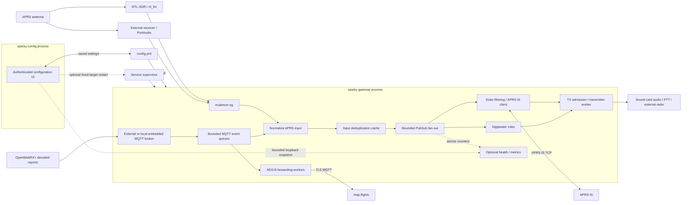
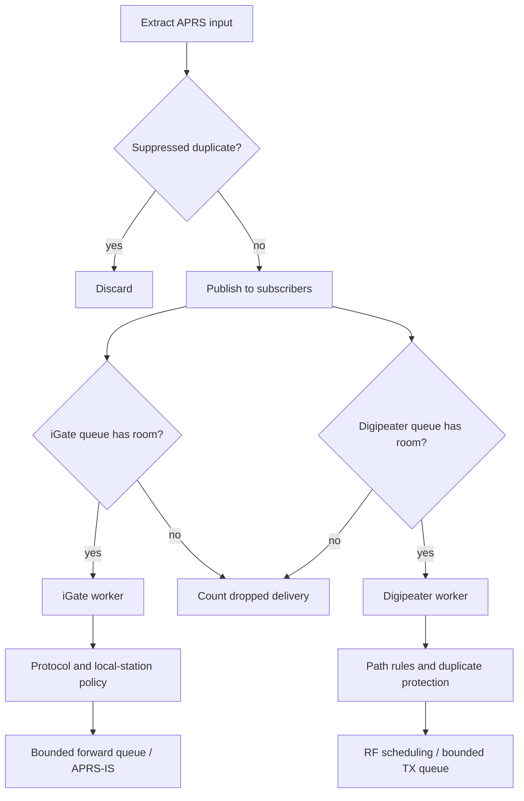
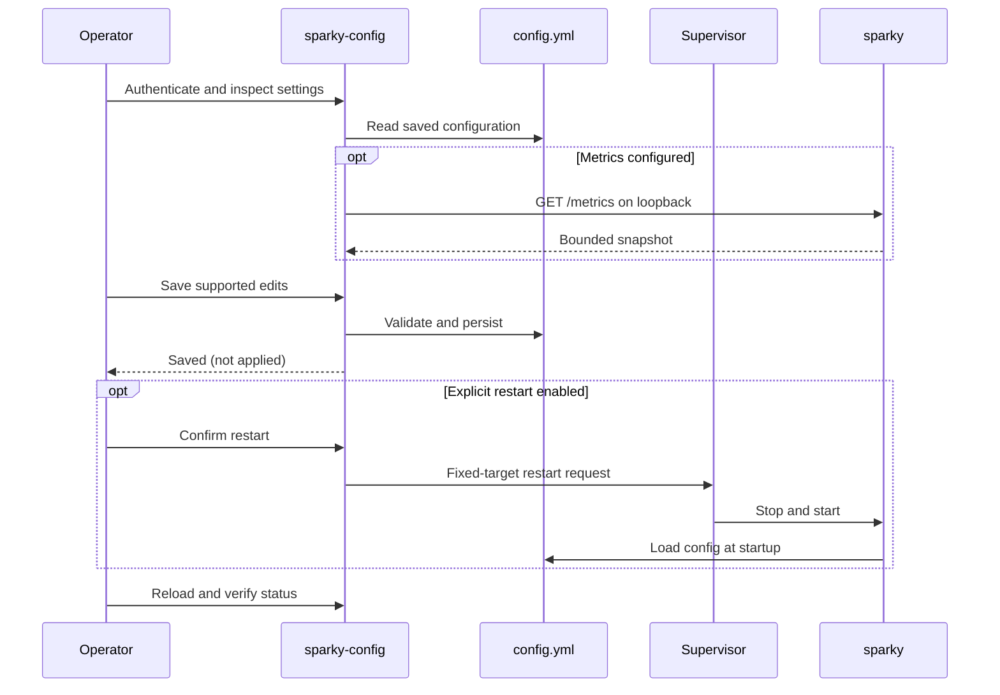

# Architecture

Sparky is a Go radio-data gateway designed for small, unattended stations. Its operating priorities are **Simple. Powerful. Fast.** This document describes the implementation on main as of the foundation work; unmerged operational metrics, installer and hardware features are not assumed.

## System at a glance

The local decoder and OpenWebRX+ receive paths are alternatives, not simultaneous independent receivers. The ADS-B branch requires OpenWebRX+ MQTT input. Sparky does not currently demodulate ADS-B samples or control a native RF transmitter module. The sound-card path needs an appropriate external radio and interface.

## Packet processing and backpressure

- PubSub serializes fan-out to maintain subscriber ordering. Each subscriber gets a bounded queue of 128 entries. A full queue drops that subscriber's new delivery without blocking other subscribers.
- Input deduplication occurs before fan-out. The local decoder deliberately allows certain self-originated duplicate frames for beacon observation.
- The MQTT input has a bounded APRS queue (256) and ADS-B queue (1024), with four ADS-B workers. These are implementation values, not configuration promises.
- The transmit queue has capacity one. Admission and cancellation are coordinated; the hardware backend must stop safely, including a blocked Play operation.
- A delivery is not a unique airframe. Local socket-write success is not confirmation of remote ingestion. Backend dispatch is not confirmation that RF was emitted.

## Process and trust boundaries

The administrative process is intentionally separate so it survives a gateway restart. Basic authentication is required; loopback is the default. Use an SSH tunnel or a restricted HTTPS proxy for remote access. The metrics listener is optional and unauthenticated; do not expose it publicly. Neither health nor readiness probes contact RF equipment or remote brokers.

## Lifecycle and reliability

Startup reserves the optional metrics listener before acquiring gateway resources. The gateway starts its input services, runs workers and handles termination signals. Shutdown signals cancellation, stops independent services concurrently and flushes the cache after workers stop. External decoder subprocesses have a single reaping owner. APRS-IS reconnection and shutdown avoid holding the connection mutex across network I/O. These mechanisms reduce failure propagation; they do not guarantee lossless delivery or successful RF reception.

## Source map

| Area | Source |
|---|---|
| Startup, signals, orchestration | [main.go](../main.go), [app.go](../app.go) |
| YAML and defaults | [internal/config](../internal/config/) |
| Capture and local decoding | [internal/capture](../internal/capture/), [internal/multimon](../internal/multimon/) |
| MQTT ingress and ADS-B forwarding | [internal/openwebrx](../internal/openwebrx/) |
| APRS parsing and APRS-IS | [internal/aprs](../internal/aprs/), [internal/igate](../internal/igate/) |
| Deduplication and fan-out | [internal/cache](../internal/cache/), [internal/pubsub](../internal/pubsub/) |
| RF forwarding and TX | [internal/digipeater](../internal/digipeater/), [internal/transmitter](../internal/transmitter/) |
| Monitoring and administration | [internal/observability](../internal/observability/), [internal/webconfig](../internal/webconfig/) |

See [performance baseline](performance-baseline.md) for the measurement methodology and [operator quick start](operator-quickstart.md) for running a station.
